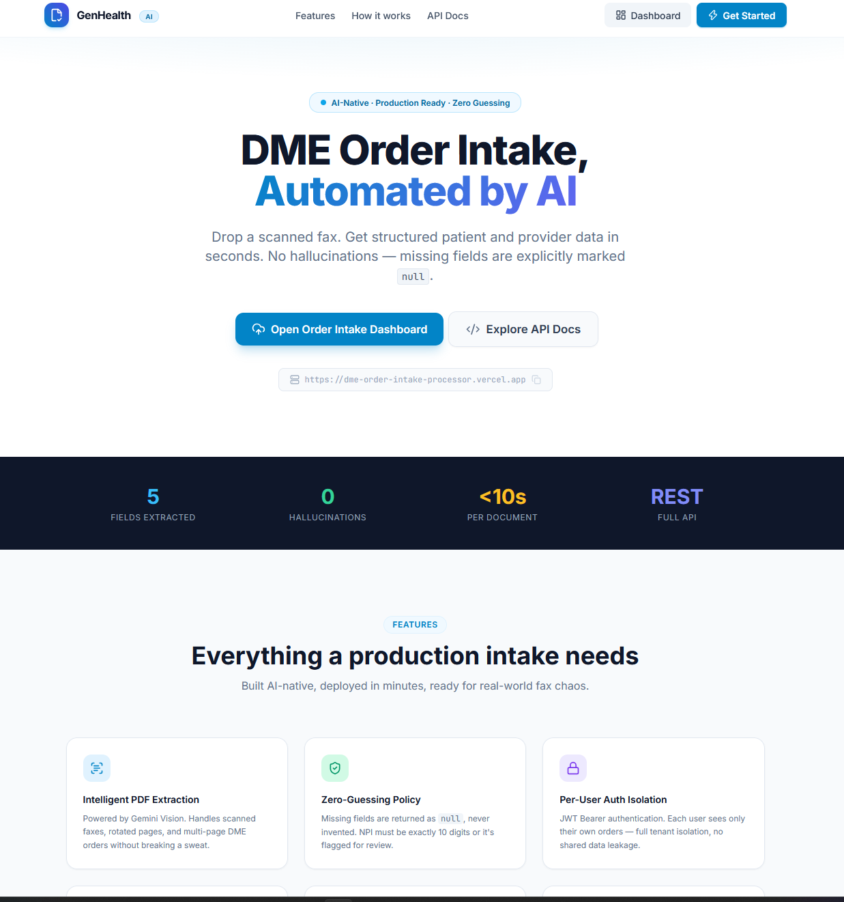
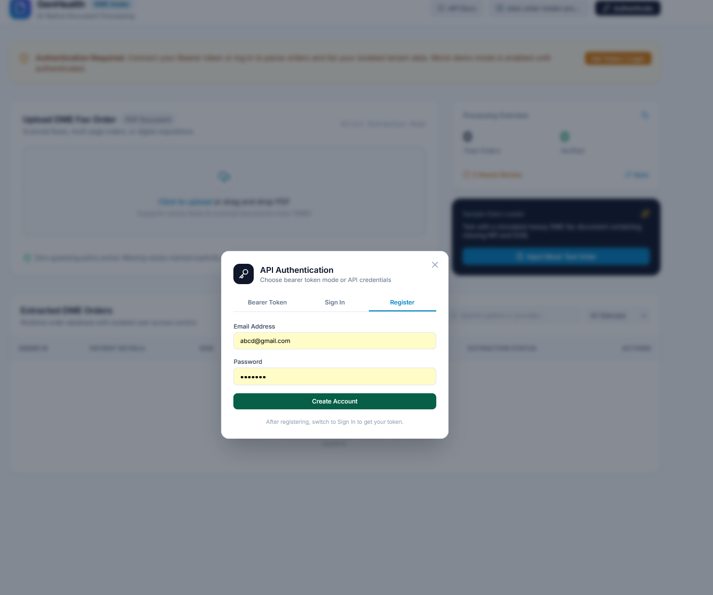
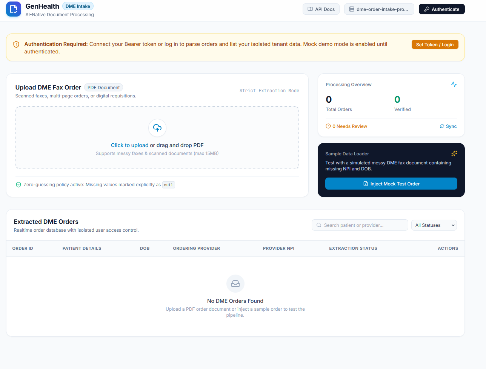
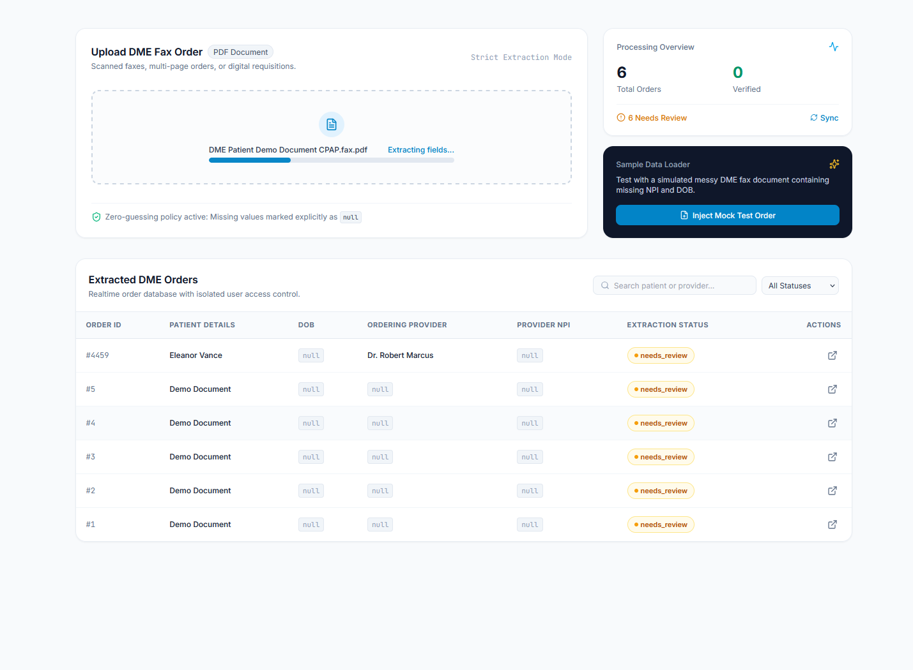

# GenHealth AI — DME Order Intake

An AI-assisted intake portal and FastAPI service for durable medical equipment (DME) orders. Upload a faxed PDF or enter an order manually; the service extracts patient and ordering-provider fields, validates them without guessing missing clinical information, and stores orders separately for each authenticated user.

## Live site

- [Landing page](https://dme-order-intake-processor.vercel.app/)
- [Order dashboard](https://dme-order-intake-processor.vercel.app/dashboard.html)
- [Interactive API documentation](https://dme-order-intake-processor.vercel.app/docs)
- [Health check](https://dme-order-intake-processor.vercel.app/health)

## What it does

1. Register an account and sign in with an email and password to obtain a bearer JWT.
2. Upload a DME order PDF or create an order manually from the dashboard.
3. Extract patient first and last name, date of birth, ordering-provider name, and provider NPI. The PDF extractor calls the Gemini REST API with `gemini-3.8-flash` and retries `gemini-3.5-flash-lite` if the primary model returns 404. If the API is unavailable, it attempts a limited plain-text heuristic extraction.
4. Validate clinical fields (including dates and the NPI checksum). Missing, illegible, or invalid fields remain `null` and the order is marked for review rather than filled in by guesswork.
5. Review, edit, list, and delete your own orders. API endpoints enforce per-user isolation.

The text-only fallback cannot reliably read scanned/image-only PDFs; configure `GEMINI_API_KEY` for multimodal extraction.

## Technology

| Component | Implementation |
| --- | --- |
| API | FastAPI, Python 3.10+ |
| Database | SQLAlchemy 2.0 with PostgreSQL (for production) or SQLite (for local use) |
| Authentication | JWT via python-jose; passwords hashed with passlib/bcrypt |
| PDF extraction | Gemini 3.8 Flash / 3.5 Flash Lite via REST, with a limited offline fallback |
| Frontend | Static HTML, vanilla JavaScript, Tailwind CSS, Lucide Icons |
| Hosting | Vercel FastAPI framework entrypoint and `public/` static files |

## Repository layout

```text
main.py                     Vercel FastAPI entrypoint
api/app/main.py              FastAPI app, routers, health check
api/app/routers/auth.py      Registration and token endpoints
api/app/routers/orders.py    Order CRUD and PDF uploads
api/app/services/            Gemini extraction and clinical validation
api/app/models.py            SQLAlchemy User and Order models
api/app/schemas.py           Pydantic request and response schemas
api/app/config.py            Environment-based settings
api/app/database.py          Database engine and sessions
public/index.html            Landing page
public/dashboard.html        Order intake dashboard
tests/                      unittest suite
run_tests.py                 Test runner
vercel.json                  Frontend-only rewrites
docs/                        Website screenshots
```

## Run locally

1. Install Python 3.10+ and create an environment from the repository root:

   ```bash
   python -m venv .venv
   # Windows PowerShell: .venv\Scripts\Activate.ps1
   # macOS/Linux: source .venv/bin/activate
   python -m pip install -r requirements.txt
   ```

2. Copy `.env.example` to `.env` at the repository root. Set a unique `SECRET_KEY`, your `DATABASE_URL`, and `GEMINI_API_KEY` if you want PDF extraction with Gemini. For a local SQLite file you can use `DATABASE_URL=sqlite:///./dme_orders.db`. The code otherwise defaults to SQLite under `/tmp`, which may not exist on Windows. Keep `.env` out of version control.

   | Setting | Purpose |
   | --- | --- |
   | `DATABASE_URL` | SQLAlchemy PostgreSQL URL in production or SQLite URL locally |
   | `SECRET_KEY` | Secret used to sign JWTs; **set this explicitly in production** |
   | `GEMINI_API_KEY` | Google AI Studio key for multimodal PDF extraction |
   | `ACCESS_TOKEN_EXPIRE_MINUTES` | Optional; code default is 1440 (24 hours) |

3. Start the API from the repository root:

   ```bash
   uvicorn main:app --reload --port 8000
   ```

   API docs are at `http://localhost:8000/docs`. In a second terminal, serve the frontend with `python -m http.server 3000 --directory public`, open `http://localhost:3000/dashboard.html`, and set **Backend Server URL** to `http://localhost:8000` in the dashboard settings. Unlike Vercel, local Uvicorn does not serve `public/` automatically.

## API

The app also mounts the authentication and order routers under `/api` (for example, `/api/auth/register`). Visit `/docs` for full request and response schemas.

| Method | Route | Authentication | Purpose |
| --- | --- | --- | --- |
| GET | `/health` | No | Service status |
| POST | `/auth/register` | No | Create an account (JSON email and password) |
| POST | `/auth/token` | No | Get JWT (form fields `username` = email, `password`) |
| GET / POST | `/orders/` | Bearer | List or create your orders |
| GET / PUT / DELETE | `/orders/{order_id}` | Bearer | Read, update, or delete an order |
| POST | `/orders/upload` | Bearer | Upload a PDF using multipart field `file` |

Example (substitute your deployment URL, credentials, and token):

```bash
curl -X POST https://<your-deployment>/auth/register \
  -H "Content-Type: application/json" \
  -d '{"email":"test@example.com","password":"secret123"}'

curl -X POST https://<your-deployment>/auth/token \
  -d "username=test@example.com&password=secret123"

curl -X POST https://<your-deployment>/orders/upload \
  -H "Authorization: Bearer <token>" \
  -F "file=@/path/to/order.pdf"
```

## Tests

From the repository root, run the entire `unittest` suite:

```bash
python run_tests.py
```

You can also run a single module, for example `python -m unittest tests.test_extractor -v`. The current suite contains **30 tests** across four modules:

| Module | What it checks |
| --- | --- |
| `tests/test_validator.py` | Placeholder and name handling, DOB parsing and invalid dates, NPI format and checksum, zero-guessing sanitization and review status |
| `tests/test_extractor.py` | LLM JSON parsing, missing-field behavior, plain-text PDF fallback, and mocked Gemini 3.8 Flash → 3.5 Flash Lite retry on 404 |
| `tests/test_database_crud.py` | In-memory SQLite user isolation, order CRUD, and persistence of missing fields as `NULL` |
| `tests/test_vercel_routing.py` | Root FastAPI entrypoint and rewrites that do not send API paths to Python filenames |

Gemini HTTP requests are mocked in tests; this suite does **not** test a live Gemini key or the deployed Vercel site.

## Deploy on Vercel

Import the repository as a Vercel project and set `SECRET_KEY`, a persistent PostgreSQL `DATABASE_URL`, and `GEMINI_API_KEY` in project environment variables. The root `main.py` exports the FastAPI app so API paths reach FastAPI directly; `public/` is served as static assets. `vercel.json` only rewrites `/` and `/dashboard` to their HTML pages. Do not rewrite `/auth`, `/orders`, or `/api` to a Python filename.

The default SQLite path is local/ephemeral on serverless hosting; use a persistent database for production user accounts and orders. After deployment, check `/health`, `/docs`, and an actual registration/login flow.

## Website screenshots

### Landing page



### Account registration



### Order dashboard



### PDF extraction


